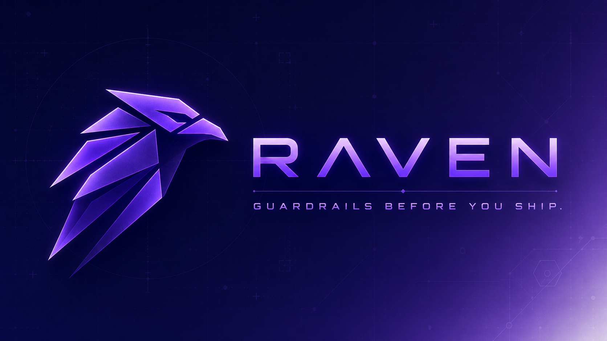

<p align="center">
  
</p>

# Raven v6.1.4 — The Open-Source Solution to AI Comprehension Debt.

AI Engineering Discipline for Comprehension Debt. Andie, the multi-dimensional thinking agent, pressure-tests the change from every angle before a line is written.

**Raven is the open-source solution to AI comprehension debt — a local AI Engineering Control Plane built to fight the two things AI coding actually breaks: discipline (code shipping faster than the thinking behind it) and comprehension debt (nobody remembering what the AI wrote, or why). One governed local layer routes each prompt to the right expert, blocks secrets and vulnerable code at the source, meters every token and dollar with verified math, and keeps your team's decisions in a memory that outlives the session.**

AI codes fast. Raven enforces Discipline — Strategic Thinking, Scalable Structure, Security at Source. How, in simple terms:

- **Strategic Thinking** — done by two orchestrators, picked automatically based on what you're doing:
  - **Andie** — for an enhancement or a new feature. Validates first, then the guided explanation, then waits for your go before touching code.
  - **Andie-Jr** — for a bug, error, or fix. Finds the root cause first, then the guided explanation. It does not take new design.
- **Scalable Structure** — Jev, TypeSafe System 1, picks the approved model for the prompt. 61 specialists, one per domain, are still named in a one-line note saying who is handling the work and why. If Jev does not answer, the keyword tier is used. Works the same on one repo or a hundred.
- **Security at Source** — guards run on your machine, at the moment code is written and committed: secrets are blocked, vulnerable libraries are blocked, and edits are blocked until the thinking actually happened. Not a report after the damage — a gate before it.

All local. Zero telemetry. MIT.

## Jev

Jev is [TypeSafe System 1](https://docs.typesafe.ai/concepts/system-one), a hosted decision model. It does not write code, edit files, or call tools. You send it text and a closed list of choices. It returns one choice and a confidence score. Raven decides what to do with that answer.

**What Raven uses it for.** On every prompt, the router asks Jev which approved model should handle the message. The choices are this host's SIMPLE, MEDIUM, and COMPLEX models. Opus and Fable are not in the list. If Jev's confidence is at least 0.55 and the choice is on the list, that model is the recommendation and the router line includes `jev`. If the key is missing, the call fails, or the confidence is low, Raven keeps the keyword tier. A prompt that looks like it contains a secret is not sent to Jev.

**How you give it the key.** `raven-setup` asks for this before any project question. A local page opens at `127.0.0.1`.

- Create a key at https://console.typesafe.ai/keys. TypeSafe calls it `TYPESAFE_API_KEY`.
- Paste it into the page, or into the field `typesafe_api_key` in `.raven/manifest.secrets.json`.
- That file is gitignored and mode 600. The key is not printed and is not committed.
- If a key is already stored, setup skips the page.

The call is `POST https://api.typesafe.ai/v1/systemone`. The key is read from `TYPESAFE_API_KEY` in the environment, or from that secrets file.

`#comprehension_debt` `#ai_coding` `#claude_code` `#grok` `#codex` `#cursor` `#discipline_engine` `#token_cost` `#secret_scan` `#cve` `#mcp` `#obsidian` `#agent_memory`

## Plugin — what you can do

The current plugin zip is [`plugin/raven-plugin-v6.1.4.zip`](plugin/raven-plugin-v6.1.4.zip). The previous zip is [`plugin/raven-plugin-v6.1.3_old.zip`](plugin/raven-plugin-v6.1.3_old.zip). Older plugin zips (v4.1.0 and v5.5.0 through v5.5.7) are packed in [`plugin/version.archive.zip`](plugin/version.archive.zip). Same current zip for Claude Code, Claude Desktop, and the other hosts (`install-host.sh`).

| You want to | In the plugin |
|---|---|
| Plan new work | **Andie** — 3-angle plan, wait for go-ahead |
| Debug existing code | **Andie-Jr** — 2-round root cause → fix |
| Route every prompt | Jev picks the approved model; `model-router.py` prints `🔀` and falls back to the keyword tier |
| See spend | Local dashboard + `/run-costs` (calculator; billed $ if API keys in env) |
| See the repo | OKF **Graph** (files/commits, search, open file) |
| Stop secrets / CVEs | Pre-commit + skills: secret scan, CVE gate |
| Work in Grok / Codex / Cursor / AntiGravity | `/raven-init` or `/raven-debug` runs `host-ensure.py --open` (python wrapper + `.agents/agents.md` + dashboard) |
| Slash commands | `/raven-init`, `/raven-debug`, `/run-costs`, `/andie`, `/andie-jr`, … |

Calculator spend is local. Check **actual billed** cost on the Costs pane or `/run-costs`.

## Install

Raven ships as its **own GitHub-hosted marketplace** (`.claude-plugin/marketplace.json` at the repo root, one plugin, `source: "./"`). It is not listed in Anthropic's official plugin directory. Pick one:

1. **Marketplace (Claude Code, recommended)**

   ```bash
   claude plugin marketplace add giggsoinc/raven
   claude plugin install raven@raven
   ```

   Claude clones the whole repo and uses the repo root as the plugin root. That is why every symlink in this repo must be relative and must stay inside the repo — see [Packaging rules](#packaging-rules-for-publishers).
2. **Current zip (every host)** — [`plugin/raven-plugin-v6.1.4.zip`](plugin/raven-plugin-v6.1.4.zip). Claude: unzip, then `claude plugin install <extracted-dir>`. Other hosts: `bash install-host.sh /path/to/project` (see [plugin/HOSTS.md](plugin/HOSTS.md)). The zip holds real files only, no symlinks, and does not include the MCP server. The previous zip is [`plugin/raven-plugin-v6.1.3_old.zip`](plugin/raven-plugin-v6.1.3_old.zip). Older zips sit in [`plugin/version.archive.zip`](plugin/version.archive.zip).
3. **Let Claude do it** — inside a Claude Code session, ask Claude to run the two marketplace commands in Option 1 for you.

Do not install from `./raven/plugin`. That folder is a build and packaging area, not a plugin root: its `scripts/` links point at the repo-level `raven-core/` and `scripts/` folders, which a copy of `plugin/` alone does not contain.

Full walkthrough (enterprise admin upload, org-wide managed deployment, troubleshooting): [claude_plugin_readme.md](./claude_plugin_readme.md)

Then restart your session. You should see the Raven greeting:

```
🪶 Raven ✅  |  {your-project}  |  {stack}
   Andie is your discipline layer. What are you working on?
```

## Getting Started — After Install

The plugin gives Claude the skills and guards. Each **project** still needs a one-time setup pass for hooks, engine scripts, and a manifest:

```bash
bash <(curl -fsSL https://raw.githubusercontent.com/giggsoinc/raven/main/install.sh)   # once per machine
cd your-project && raven-setup                                                         # once per project
```

Two files come out of this setup, in plain terms:
- **`.raven/manifest.json`** — your project's config card: what language/stack you use, solo or team mode, which guard rules are on. Andie and the guards read this before doing anything, so they act like a Postgres expert on a Postgres project instead of guessing.
- **`.raven/manifest.secrets.json`** — only needed if you want commit/block email or Slack alerts. It holds those notification credentials, is gitignored by default, and everything works fine without it (Raven just skips notifications silently).

### New repo (greenfield)

`raven-setup` finds no file signatures in an empty directory, so it asks 1–3 quick questions (mode: solo/team/enterprise, primary language, cloud provider) and builds `.raven/manifest.json` entirely from your answers. Start working normally — Andie routes every prompt and guards activate as soon as files exist.

### Existing repo (brownfield)

`raven-setup` runs a detector that auto-classifies the work type (code / infra / data / docs / salesforce / odoo / mixed) from file signatures already in your repo. **Known limitation:** that only sets the work-mode label — it does not read `package.json`/`requirements.txt`/etc. to auto-fill the manifest's stack fields, so you'll still be asked to manually pick languages, databases, and cloud provider even though that info is already in the repo. If `.raven/manifest.json` already exists, setup skips straight to "already configured."

This is also where **Andie-Jr** earns its keep: once the manifest is in place, any bug report on this existing codebase gets a 2-round root-cause triage instead of an open-ended investigation — faster than either a from-scratch plan (Andie) or no structure at all (plain Claude).

## Quick start

| You type | What happens |
|---|---|
| `why is auth failing since yesterday?` | routed to **andie-jr** — 2-round triage: root cause → fix → audit note |
| `should we use Postgres or Mongo here?` | routed to **andie** — one mode card, 3-angle review, you approve each step |
| `/andie` or `/andie-jr` | force the route explicitly |
| `git commit` with a staged API key | **hard block** at the pre-commit gate, with the line that triggered it |
| `rename this variable` | routed nowhere — trivial edits skip the ceremony |

## What's included

- **2 orchestrators** — Andie (plan-first, one hard gate, critic voice) and Andie-Jr (brownfield debug, max 2 rounds)
- **Deterministic routers** — repo-state + intent routing with visible one-line toasters; never routes silently
- **61 domain skills** — FastAPI, Postgres, K8s, Terraform, Salesforce, Odoo, Oracle, AWS/GCP/Azure, and more, loaded only when your work matches
- **Local guards** — secret scan + CVE check (CVSS >7 blocks) at every commit; optional edit gate (`raven-skill-gate`, shadow/soft/hard modes); style and architecture checks
- **Cost-aware model routing** — prompts classified to the cheapest adequate tier; secret-laden context forced to a local model
- **Educate (default guided)** — `.raven/educate.json` (missing = guided). Claude PreToolUse **denies** writes until `go ahead`. Other IDEs: same loop from the boot file (`educate=`). Off: `educate off` or `Lucky` (persists; SessionStart does not wipe the file). Read-only research always passes.
- **Audit + memory** — JSONL audit logs; **human** notes in `~/RavenVault` (Obsidian + dashboard); **agent** start is **not** the vault. First load is `scripts/memory/ide-boot.py` (`load=1` → Read `.raven/memory/CARD.md` only).

## Agent memory and IDE hosts

Agents do **not** inject `~/RavenVault` or `knowledge-graph.json` at boot. `vault-load.py` is a **manual** CLI only.

| Step | What |
|---|---|
| **Stop** | `obsidian-log.py` writes the vault session note **and** `.raven/memory/CARD.md` (schema 1, project from this `manifest.json`, open questions/decisions, dashboard path). |
| **First load** | `python3 scripts/memory/ide-boot.py` — prints `host`, `rules`, `load=0\|1`, `memory=`, `educate=`. If `load=1`, Read **only** that memory path. |
| **Map** | `.raven/boot.json` — env → host → native one-line rules file. |

| Host | Env (any) | Native file (one line: run `ide-boot.py`) |
|---|---|---|
| Claude Code | `CLAUDECODE`, `CLAUDE_PLUGIN_ROOT` | `CLAUDE.md` |
| Grok | `GROK_AGENT`, `GROK_SESSION_ID` | `AGENTS.md` |
| Codex | `CODEX_HOME`, `CODEX_THREAD_ID` | `AGENTS.md` |
| Cursor | `CURSOR_AGENT`, `CURSOR_TRACE_ID` | `AGENTS.md` |
| AntiGravity | `ANTIGRAVITY`, `ANTIGRAVITY_CLI_ALIAS` | `.agents/agents.md` |
| Windsurf | `WINDSURF`, `WINDSURF_IDE` | `.windsurf/rules/ide-boot.md` |
| Replit | `REPL_ID`, `REPL_OWNER` | `replit.md` |
| Gemini CLI | `GEMINI_CLI` | `GEMINI.md` |
| unknown | none of the above | `AGENTS.md` + card still if `load=1` |

Claude `SessionStart` runs `session-start.py` only (**no** `vault-load`). Codex/Grok/Cursor have no Claude hooks — they rely on `AGENTS.md` + the router. Dashboard for humans: `~/RavenVault/dashboard.html`. Details: [docs/RAVENVAULT-GRAPH-AND-MEMORY.md](docs/RAVENVAULT-GRAPH-AND-MEMORY.md). Later-removal candidates (shims, old digest, vault KG on the dashboard): [docs/DEPRECATIONS.md](docs/DEPRECATIONS.md) — **do not delete in this version**.

## When to Use Raven — Use Case Table

| Scenario | Raven | Plain Claude | Notes |
|----------|-------|-------------|-------|
| **Brownfield bug** — *"Why is auth timing out?"* | ✅ Faster | ❌ | 2-round triage beats open-ended; forces root cause before fix. |
| **Architecture decision** — *"Should we migrate to Postgres?"* | ✅ Better | ❌ | Triad (Functional/Tech/Data) catches angles one perspective misses. |
| **Commit-time security** — prevent secrets/CVEs shipping | ✅ Hard-block | ❌ | Pattern-based detection; reduces risk, not foolproof. |
| **Routine feature work** — *"Build me a login form"* | ❌ Slower | ✅ Faster | Raven adds ceremony; plain Claude is direct. |
| **Quick lookup** — *"What's the CloudRun pricing?"* | ❌ Overkill | ✅ Direct | No decision needed; Raven's routing overhead is wasted. |

---

## Andie + Andie-Jr: The Decision Duo

### Andie (Architecture, Design, Strategy)

Runs a **Drama panel debate** when your decision has tradeoffs:
- **Functional Lead** — business/domain owner perspective
- **Technical Lead** — system/implementation owner perspective
- **Data Lead** — metrics/integration owner perspective

Each panelist argues their angle. You steer the debate. Final output: **decision + rationale + rejected alternatives + risks**.

### Andie-Jr (Brownfield Triage)

For broken systems: **problem → diagnosis → fix → audit**.
- Round 1: 2 clarifying questions that isolate the root cause.
- Round 2: Root-cause explanation + fix + verification steps + audit note.

Not for greenfield builds; only for existing systems showing symptoms (errors, timeouts, regressions).

### Routing Table

| Scenario | Route | How |
|----------|-------|-----|
| **Brownfield bug** ("why is X broken?") | andie-jr | Repo >1 commit + symptom language detected |
| **Greenfield or architecture** ("should we...?") | Andie | Repo ≤1 commit OR Drama-mode intent |
| **Data question** ("what is...?", "list...", "show...") | Direct | No change verbs (build, fix, create); no routing overhead |
| **Force path** (`/andie`, `/andie-jr`) | Explicit | User typed the skill name — routing wins always |

---

## How Raven Works — The Full Stack

### Architecture Overview

```
UserPromptSubmit (every message)
  ↓
triage-router.py [deterministic repo-state]
  ├─ Brownfield (>1 commit) → andie-jr
  ├─ Greenfield (≤1 commit) → Andie
  ├─ Data question (read/list/explain, no change verbs) → direct
  └─ Force path (/andie, /andie-jr) → always wins
  ↓
[Specialist runs, edit/commit allowed]
  ↓
PostToolUse: secret-scan.py (after Write/Edit)
  ├─ AWS keys, OpenAI keys, GitHub tokens, SSH, bearer tokens → WARN
  └─ Send intent to audit log (`.raven/audit/YYYY-MM-DD.log`)
  ↓
Pre-commit hook (.git/hooks/pre-commit)
  ├─ secret-scan.py → HARD BLOCK if secrets staged
  ├─ cve-check.py (new imports) → HARD BLOCK if CVSS >7
  ├─ style-enforcer (line count, type hints, docstrings) → HARD BLOCK if violated
  ├─ architecture-guard (doc alignment) → WARN now, block in 24h
  ├─ db-guard (inline SQL, missing ERDs, migration order) → WARN
  └─ notify.py (SMTP + Slack) → send pass/fail summary + audit
  ↓
Commit lands (or blocked + approval flow starts)
```

### 7 Guard Agents — What They Check

| Guard | Fires | Detects | Action |
|-------|-------|---------|--------|
| **manifest-checker** | SessionStart | Missing `.raven/manifest.json` | Hard stop with setup guide |
| **secret-guard** | PostToolUse + pre-commit | AWS keys, tokens, SSH, PII in staged files | Warn on edit / hard block on commit |
| **cve-check** | New `import X` statement | Library vulnerabilities (CVSS >7) | Warn during coding / hard block at commit |
| **stack-validator** | Import detected + not in approved list | Unapproved libraries (Polars vs Pandas, etc.) | Warn / block at commit |
| **style-enforcer** | File edit | Line count >200, missing type hints, no docstrings | Advise / block at commit |
| **architecture-guard** | New file created | Missing `.raven/architecture.md` documentation | Warn / hard block after 24h grace |
| **db-guard** | File edit (SQL, migrations) | Inline SQL in non-SQL files, missing ERDs, broken migration numbering | Warn in audit log |

### Notifications (SMTP + Slack)

Fires from pre-commit hook on success or block:
- **Commit pass**: Confirmation email + Slack (to recipients in `.raven/manifest.secrets.json`)
- **Commit blocked**: Alert with violation count + Slack
- **Override used**: Log to audit trail + email
- **Token warning**: 75% / 90% thresholds

---

## Plugin anatomy — what is actually wired

Everything below was read from the validated manifests (`claude plugin validate .` passes), not described from memory.

### Hooks (`hooks/hooks.json`)

Every Python hook runs through `scripts/ops/hook-run.py`. If a hook script is missing, `hook-run.py` writes `.raven/audit/` and exits 0, so a missing script never blocks your prompt or a tool call.

| Event | Matcher | What runs |
|---|---|---|
| `SessionStart` | all | `session-start.py`, `ide-boot.py --session-start`, `model-router.py --session-start`, `run_costs.py --session-start`; clears stale `.raven/.push-*` markers |
| `UserPromptSubmit` | all | `memory-card-hook.py` → `triage-router.py` → `architect-router.py` → `model-router.py --hook` → `cve-prompt-guard.py` → `push-approve.py` |
| `PreToolUse` | `Write\|Edit\|MultiEdit\|NotebookEdit\|Bash` | `route-gate.py`, `push-gate.py` (the Educate gate) |
| `PreToolUse` | `Skill` | `raven-skill-gate.py` |
| `PostToolUse` | `Write\|Edit\|MultiEdit` | `db-guard.py`, `secret-scan.py --changed-files-only` |
| `Stop` | all | `token-meter-write.py`, `token-guard.py`, `dashboard.py --html --if-stale 15`, `obsidian-log.py`, `knowledge-extract.py`, `session-gate.py`, `code-xray.py`, `memory-card-hook.py --event exit` |

The git pre-commit hook is separate and is **not** a Claude Code hook. It is installed into your project's `.git/hooks/` by `raven-setup`.

### MCP server (`.mcp.json` → `mcp/server.py`)

A stdio server, launched as `python3 ${CLAUDE_PLUGIN_ROOT}/mcp/server.py`. `CLAUDE_PLUGIN_ROOT` is the installed plugin directory, so it works for every user. (Earlier builds used `${CLAUDE_PROJECT_DIR}`, which is the *user's* project, so a marketplace install could not find the server.) Tools: `raven_status`, `raven_cve_check`, `raven_sync_libs`, `raven_debug`, `raven_violation`, and the knowledge-graph tools `query_graph`, `get_node`, `get_neighbors`, `shortest_path`, `commit_impact`, `find_gaps`. The zip does not include the MCP server; it ships with the marketplace install and the repo.

### Slash commands (`core/commands/`)

`/andie`, `/andie-jr`, `/raven-init`, `/raven-debug`, `/raven-approve`, `/raven-harden`, `/raven-incident`, `/raven-scaffold`, `/raven-search`, `/raven-sync`, `/raven-registry-register`, `/raven-registry-sync`, `/run-costs`.

### Guard agents (`agents/`)

`architecture-guard`, `claude-mem`, `db-guard`, `guard-git-watch`, `manifest-checker`, `odoo-guard`, `salesforce-guard`, `skill-guard`, `stack-validator`, `style-enforcer`.

### Skills (`skills/`)

One folder per skill, each with a `SKILL.md`. The orchestrators (`andie`, `andie-jr`), the routing and discipline skills (`raven-core`, `raven-plan`, `raven-review`, `raven-security`, …) and the domain specialists (cloud, data, databases, Kubernetes, Terraform, Odoo, Salesforce, Oracle, and more) live here. Domain skills load only when your work matches. `skills/MANIFEST.json` is generated by `scripts/ops/build-skill-manifest.py`.

---

## Repository layout

| Path | What it is |
|---|---|
| `.claude-plugin/` | `marketplace.json` and `plugin.json` — the manifests the marketplace reads |
| `hooks/hooks.json` | Plugin hooks (generated) |
| `.mcp.json`, `mcp/` | MCP server config and server code |
| `skills/`, `agents/`, `core/commands/` | Skills, guard agents, slash commands |
| `scripts/` | Engine: `routing/`, `guards/`, `memory/`, `session/`, `ops/`, `dashboard/` |
| `raven-core/` | Canonical `VERSION` plus a flat set of script entry points (symlinks into `scripts/`; `schema-guard.py` is a real file here) |
| `plugin/` | Zip build (`make-plugin.sh`), host installers, built zips. Not a plugin root |
| `.claude/` | This repo's own Claude settings; `.claude/scripts/*` are symlinks into `scripts/` and `raven-core/` |
| `tests/` | Regression tests (`python3 -m unittest discover tests`) |
| `docs/` | Architecture, tokenomics, skill gate, dashboard, memory, deprecations |
| `.github/workflows/raven-discipline.yml` | CI |

---

## Packaging rules (for publishers)

A marketplace install copies the repo, so the repo must be self-contained. These are the rules that decide whether it can be published:

1. **No dangling symlinks.** `find . -xtype l -not -path './.git/*'` must print nothing.
2. **No absolute symlink targets.** A link to `/Users/<you>/...` resolves on your machine and nowhere else. Always use relative targets.
3. **No symlink may leave the repo root.** Links under `.claude/scripts/`, `raven-core/` and `plugin/scripts/` point at `scripts/` or `raven-core/` inside the same repo.
4. **Use `${CLAUDE_PLUGIN_ROOT}`** for anything a hook or MCP server launches from the plugin. Use `${CLAUDE_PROJECT_DIR}` only for the user's project files.
5. **Versions agree.** `raven-core/VERSION` is canonical. `python3 scripts/ops/check-version-consistency.py` checks the manifests against it.
6. **Validate before you push:** `claude plugin validate .`
7. **No stale references.** Every relative link in a Markdown or HTML file, and every `scripts/...` path named in a doc, hook config, workflow or build script, must resolve. When a script moves (for example into `scripts/ops/`), grep for its old path.
8. **CI must run for real.** The five `Raven Discipline` jobs resolve the repo root as `Path(__file__).resolve().parents[2]` from `scripts/ops/`. One level too shallow makes a check scan nothing and pass. A skill-manifest check that says `0 skills registered` is that bug.

A one-line check for rules 1–3 against a fresh clone:

```bash
git clone --no-hardlinks . /tmp/raven-check && cd /tmp/raven-check && find . -xtype l -not -path './.git/*' | wc -l   # expect 0
```

---

## Release process

1. Write the change. Add a newest-first entry to [VERSIONLOG.md](VERSIONLOG.md).
2. Bump `raven-core/VERSION`, then the version in `.claude-plugin/marketplace.json` (twice), `.claude-plugin/plugin.json`, `plugin/.claude-plugin/plugin.json`, `plugin/plugin.json`, `plugin/settings.json`, `.claude/settings.json`, `core/hooks/settings.json`, `.raven/manifest.json`, `scripts/dashboard/core.py`, `plugin/make-plugin.sh`, both `CLAUDE.md` files and `plugin/HOSTS.md`. Append the version to `plugin/scripts/releases.json`.
3. Run the five CI checks (`check-engine-drift.py`, `check-docs-vs-reality.py`, `export-hook-configs.py --check`, `build-skill-manifest.py --check`, `check-version-consistency.py`, all under `scripts/ops/`) and `python3 -m unittest discover tests`.
4. Run `claude plugin validate .` and the fresh-clone symlink check above.
5. Build the zip from a **clean checkout** so it cannot pick up uncommitted skills: clone the repo, run `bash plugin/make-plugin.sh` there, copy the zip into `plugin/`.
6. Commit and push to `main`.

---

## Verify your install

| Check | Expected |
|---|---|
| Start a new Claude Code session | A `🪶 Raven` session-start banner and a `🔀 Router` line on each prompt |
| `claude plugin validate .` in a clone | `Validation passed` (warnings are not failures) |
| `python3 scripts/ops/ide-boot.py` in your project | Prints `host=`, `rules=`, `load=`, `memory=`, `educate=` |
| `git commit` with a staged fake key | Blocked by the pre-commit gate |

## Troubleshooting

| Symptom | Cause and fix |
|---|---|
| Marketplace rejects or flags the plugin | Run the packaging checks above. The usual cause is a dangling or absolute symlink |
| `raven` MCP server shows `Connection closed` | The launch path did not resolve. It must be `${CLAUDE_PLUGIN_ROOT}/mcp/server.py`, and `python3` must be on `PATH` |
| Writes are denied with a go-ahead prompt | The Educate gate is on (default). Reply `go ahead`, or `educate off` / `Lucky` to turn it off |
| A hook seems to do nothing | `hook-run.py` skips a missing script and logs it under `.raven/audit/` — read the newest log there |
| `claude plugin install ./raven/plugin` fails or lacks skills | `plugin/` is not a plugin root. Use the marketplace commands or the zip |

---

## Tokenomics — What Raven Costs Per Message

**Rule: enforcement runs in Python hooks, outside the model — it costs zero
tokens.** Gates, guards, scanners, audit logs, and the pre-commit pipeline
never enter Claude's context. Only the thin advisory layer does:

| Layer | Frequency | Tokens |
|---|---|---|
| Hooks: skill gate, secret scan, CVE, pre-commit, token guard | every tool call / commit | **0** |
| Skill-reminder + router toasters (context injection) | per message | ~100 |
| Session boot (greeting + transparency banner) | once per session | ~500 |
| Specialist SKILL.md load (when a skill actually runs) | once per session | ~1–2k |
| Violation messages (block/warn) | only on violation | ~50 |

Steady-state: **~2% overhead** on a typical session — and the model router
(0-token hook) claws that back by tiering simple prompts to cheaper models and
routing secret-laden context to a free local model. Full breakdown, including
where Raven saves tokens: [docs/TOKENOMICS.md](docs/TOKENOMICS.md) ·
diagrams: [business view](docs/AUDIT/Agent_token_architecture_business.html) ·
[technical view](docs/AUDIT/Agent_token_architecture_tech.html).

---

## Raven 6.1

Raven 6.1.4 is the current release; the 6.1 line is described below. The 6.0 zip is removed so the updater sees this build. One plugin covers Claude, Grok, Codex, Cursor, Windsurf, VS Code, AntiGravity, Gemini, and Replit.

**How Jev works.** See [Jev](#jev) above. Setup opens the local key page first. After the key is stored, each prompt is sent to System 1. Jev only chooses an approved model. It does not run the prompt, and Raven does not read a TypeSafe token balance.

**What you can do after that question.** Raven asks what you prefer:

1. **Use a local model.** It checks Ollama at `127.0.0.1:11434` and LlamaCPP at `127.0.0.1:8080`. If both are running, Ollama is flash (`SIMPLE`) and LlamaCPP is thinking (`MEDIUM` and `COMPLEX`). If only one is running, that one is both. The model names are written to `.model.env`. No key is written for a local server.
2. **Add any other model.** You type a model id, such as `groq/llama-3.3-70b`, and paste that provider’s key. The key goes in the same secrets file as `<provider>_api_key`. The model id is used for both flash and thinking.
3. **Keep the current defaults.** Nothing is changed.

Run it again with `python3 scripts/ops/jev-key.py`. `python3 scripts/ops/jev-key.py --set` saves a TypeSafe key from the hidden prompt. `--save-env` saves the `TYPESAFE_API_KEY` already in the environment. The choice is remembered in `.raven/setup-choice.json`, which is gitignored. If that file exists, setup does not ask again.

**Ask order.** A bug, error, or fix goes to Andie Jr, then the guided explanation. An enhancement or new feature goes to Andie, then the guided explanation. The skill gate blocks an edit until that reviewer and Guided are both stamped. The other reviewer does not unlock the edit.

**What this repo holds now.** `main` is the only branch. The install file is `plugin/raven-plugin-v6.1.4.zip`. The previous zip is `plugin/raven-plugin-v6.1.3_old.zip`. Older plugin zips are inside `plugin/version.archive.zip`. Secret and CVE blocks, local token and cost metering, the dashboard, and cross-session memory are still in this release. The written history of older releases stays in [VERSIONLOG.md](VERSIONLOG.md).

---

## Other Install Paths

**Current ZIP (all hosts):** [`plugin/raven-plugin-v6.1.4.zip`](plugin/raven-plugin-v6.1.4.zip). Claude Desktop: Settings → Extensions → Add plugin. Other IDEs: `bash install-host.sh` (see [plugin/HOSTS.md](plugin/HOSTS.md)). Previous zip: [`plugin/raven-plugin-v6.1.3_old.zip`](plugin/raven-plugin-v6.1.3_old.zip). Older zips: [`plugin/version.archive.zip`](plugin/version.archive.zip).

**From source:**

```bash
git clone https://github.com/giggsoinc/raven.git
cd raven && bash plugin/make-plugin.sh   # rebuilds plugin/raven-plugin-v6.1.4.zip
```

---

## Contributing

Raven is MIT licensed. Contributions welcome. See [CONTRIBUTING.md](CONTRIBUTING.md) for:
- How to add a skill
- How to write a guard agent
- Style standards (Giggso code style — type hints, docstrings, logging, ≤200 LOC per file)
- Pre-commit hook requirements

---

## Raven Enterprise

This repo is the **free tier — everything runs local**, MIT-licensed, complete as-is.

**Raven Enterprise** (paid, sold separately) adds what teams and compliance departments need on top: Hub dashboards across developers and repos, per-developer token attribution and chargeback, compliance/audit reporting, centralized policy sync, and commercial support.

→ [giggso.com](https://giggso.com)

---

## Support & Issues

- **Bug reports**: [GitHub Issues](https://github.com/giggsoinc/raven/issues)
- **Questions**: Start a discussion in [GitHub Discussions](https://github.com/giggsoinc/raven/discussions)
- **Security vulnerabilities**: Email `rv@giggso.com` (do not open public issue)

---

<p align="center">
  <strong>Built by <a href="https://giggso.com">Giggso</a> · <a href="https://github.com/giggsoinc/raven">GitHub</a> · MIT License</strong>
</p>

*Raven 6.1.4 — one plugin, every host. Governance for AI coding at the speed of thought.*
